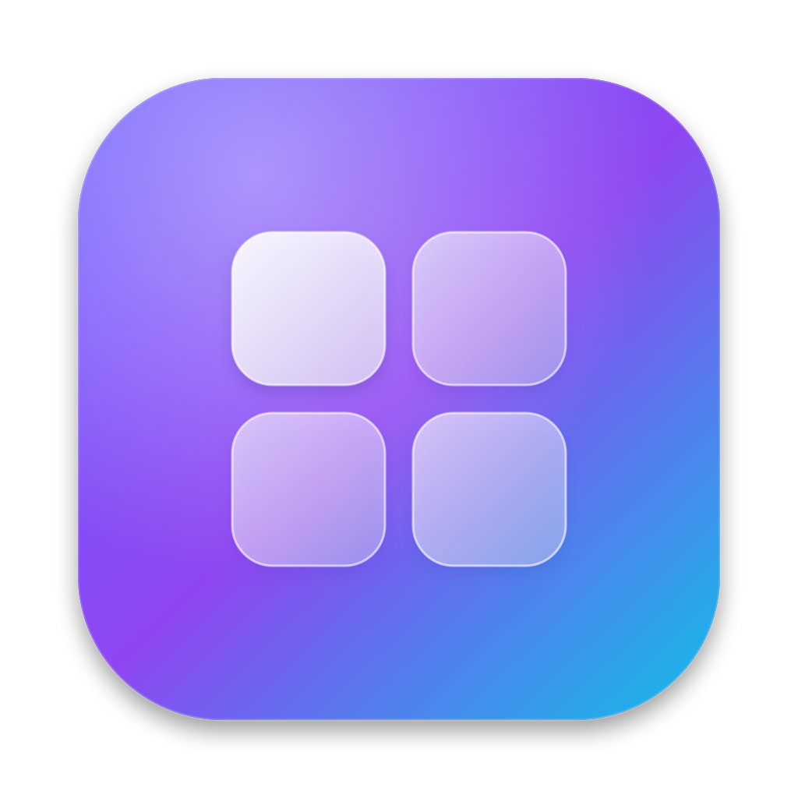
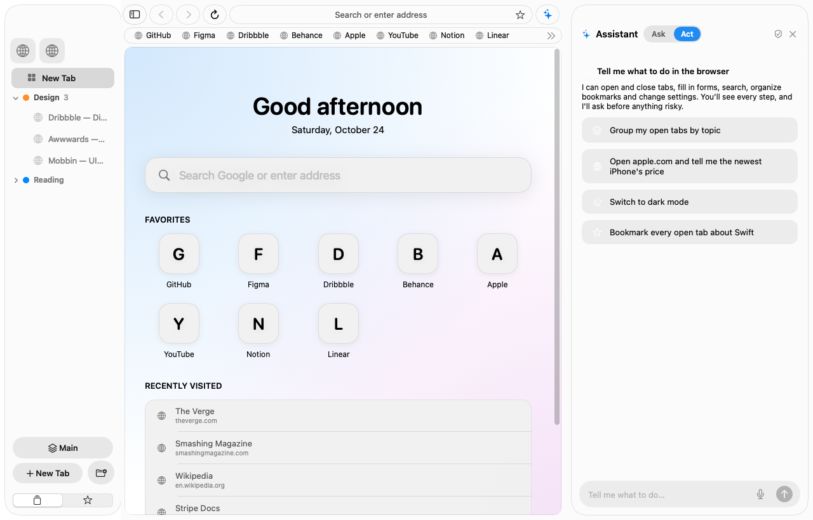
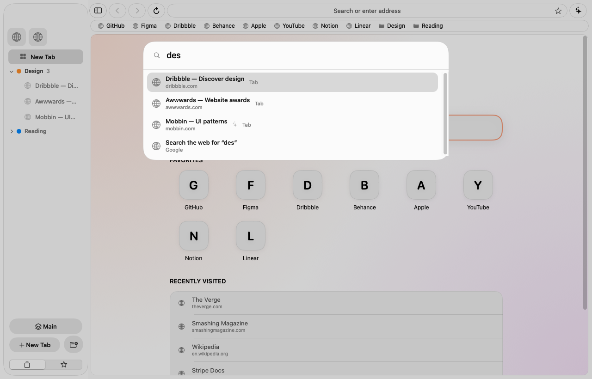
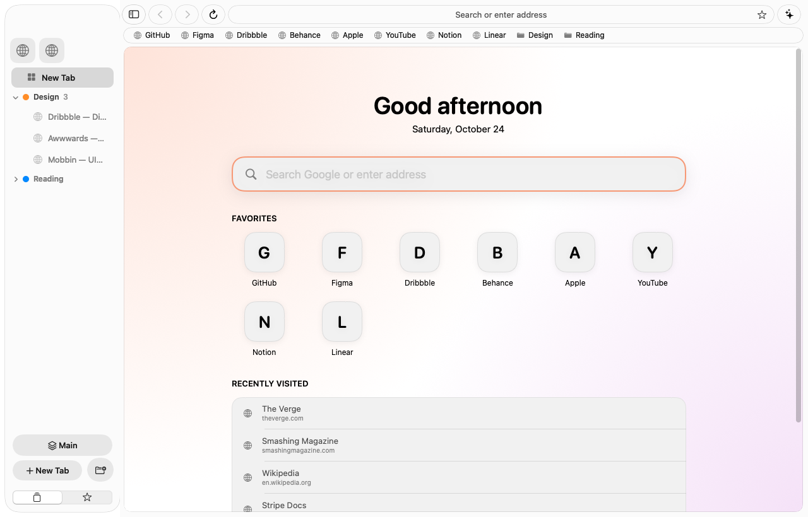
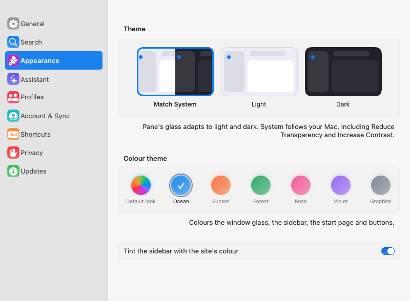
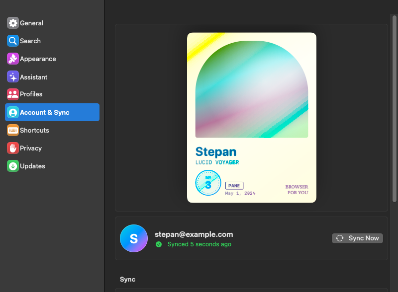

<div align="center">



# Pane

**A native macOS browser on Chromium — with Liquid Glass, vertical tabs and an AI agent that can browse for you.**

[](https://pane.2-26-86-13.sslip.io/Pane.dmg)
&nbsp;


*Нативный браузер для macOS на Chromium: стеклянный интерфейс, вертикальные вкладки, ИИ-агент. Интерфейс на русском и английском.*



</div>

## Download

**[⬇ Download Pane.dmg](https://pane.2-26-86-13.sslip.io/Pane.dmg)** (Apple-silicon Macs, macOS 26 or newer). Open the disk image and drag Pane to *Applications*. Pane updates itself: when a new version is out, an **Update** button appears in the sidebar and a "What's new" card shows after installing.

> The app isn't notarized by Apple yet, so the first time: right-click **Pane → Open → Open** (or *System Settings → Privacy & Security → Open Anyway*).

## What's inside

<table>
<tr>
<td width="50%"></td>
<td width="50%"></td>
</tr>
<tr>
<td><b>⌘K palette</b> — search tabs, bookmarks and history by keywords and by meaning, with Russian word forms.</td>
<td><b>Glass everywhere</b> — light, dark and colour themes; a start page with your favourites; the sidebar takes the colour of the site you are on.</td>
</tr>
</table>

### Tabs & workspaces
Vertical sidebar, tab groups, pinned tabs, **workspaces** you can switch in one key (⌥⌘[ / ⌥⌘]), **split view** (⌥⌘\), tabs that fall asleep to save memory, profiles and private windows.

### An agent that actually browses
Switch the panel to **Act** and say what you want. The agent opens and closes tabs, searches, fills forms, organises bookmarks into folders, watches pages ("tell me when the price drops below 50 000"), compares sites and writes applications from your "About me" notes. You see every step with animations, it asks before anything risky (or turn on **auto-approve**), and it **never types passwords, card numbers or one-time codes**. Page text can't give it orders.
Past conversations are kept (clock in the panel header) and can be reopened; **private mode** makes the agent work in a separate private tab that can't see your bookmarks, history, notes or logins.
Bring your own key — Anthropic (Claude), OpenAI or any compatible server; it stays in the macOS Keychain.

### Notes & memory
Pin a **note** to any page (⌃⌥⌘N) — it pops up next time you visit and ⌘K finds it. Pane also keeps a short snippet of each page you visit, so you (and the assistant) can find "that article about prices I read on Tuesday" by what it said. Everything stays on your Mac.

### Reading tools
Reader mode (⌥⌘R) · page summary (⌥⌘S) · **page translation** (⌥⌘T) · native **PDF viewer** with search · picture in picture (⌥⌘P) · history and downloads window (⌘Y) · dictation in the assistant.

### Privacy
Ad and tracker blocking · private windows · saved logins in the Keychain, optionally synced **end-to-end encrypted** with your own passphrase · anonymous crash reports only if you agree.

<table>
<tr>
<td width="50%"></td>
<td width="50%"></td>
</tr>
<tr>
<td><b>Colour themes</b> — Ocean, Sunset, Forest, Rose, Violet, Graphite.</td>
<td><b>Member card</b> — a collectible card with your number among Pane users; it tilts and shimmers when you hover it.</td>
</tr>
</table>

## For developers

### Layout

| Module | Purpose |
|---|---|
| `CEFBridge` | Objective-C++ bridge to Chromium Embedded Framework |
| `PaneEngine` | Engine-agnostic protocols — the UI never touches CEF directly |
| `PaneCEF` | CEF implementation of those protocols |
| `PaneModel` | Pure models: tabs, workspaces, bookmarks, settings, the agent loop… |
| `PaneUI` | AppKit + SwiftUI interface |
| `PaneAssistant` | LLM providers (Anthropic, OpenAI-compatible) |
| `PaneSync` · `PaneUpdate` · `PaneSearch` · `PaneImport` | Sync client, updater, search, bookmark importers |
| `Pane` | App entry point and menus |
| `server/` | Node.js sync and crash-report server |

The engine, UI and assistant layers don't depend on each other directly.

### Build

Needs macOS 26+, Xcode with Swift 6 and Python 3.

```bash
scripts/fetch_cef.sh   # downloads the pinned CEF build into third_party/ (~480 MB)
scripts/build.sh       # builds build/Pane.app (signed with an Apple Development identity if present, else ad-hoc)
swift test             # unit tests
```

Russian strings live in `scripts/strings_ru.py` (+ `strings_ru_extra.py`); `scripts/strings_ru.py check` lists missing translations.

### Releases (maintainers)
`scripts/release.sh "notes"` builds, zips, writes the update feed and uploads it — `scripts/publish.sh` targets the author's server; change the host there. The sync server runs with `docker compose up -d` in `server/`.

`scripts/smoke_test.sh` opens the built app and checks the things that broke before (window width, stress run, quit time, PDF, picture in picture…); `release.sh` runs it before publishing.

Test runs never touch your real data: set `PANE_SUPPORT_DIR` (and `PANE_OFFSCREEN`) and the app uses its own folder, its own preferences and no sync. Many `PANE_DEBUG_*` switches (snapshots, stress runs, feature probes) are listed in `Sources/Pane/main.swift`.

---

<div align="center">Made with care in Swift · Chromium via <a href="https://bitbucket.org/chromiumembedded/cef">CEF</a></div>
